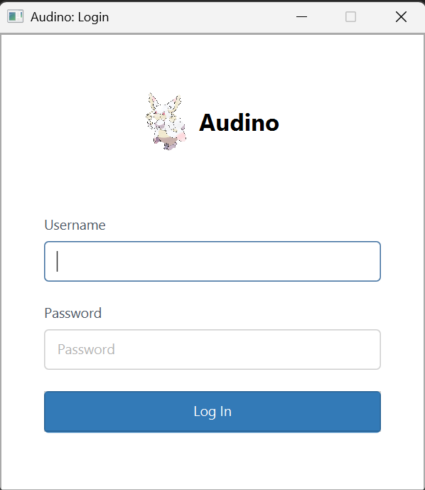
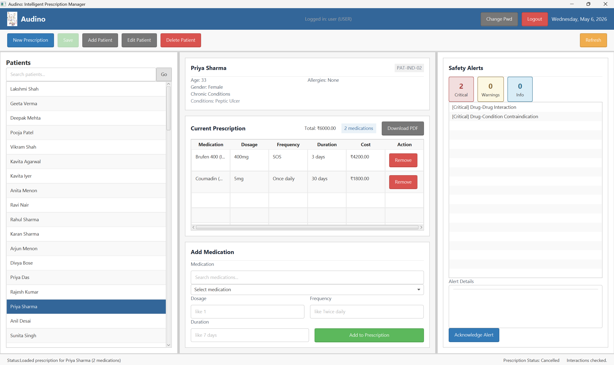
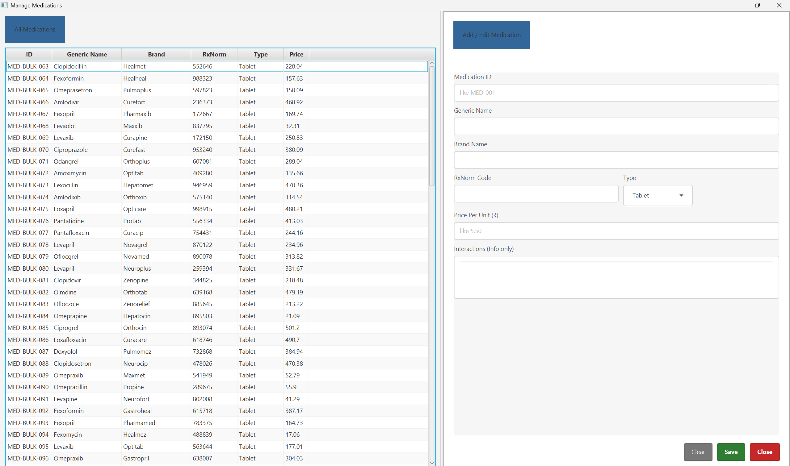
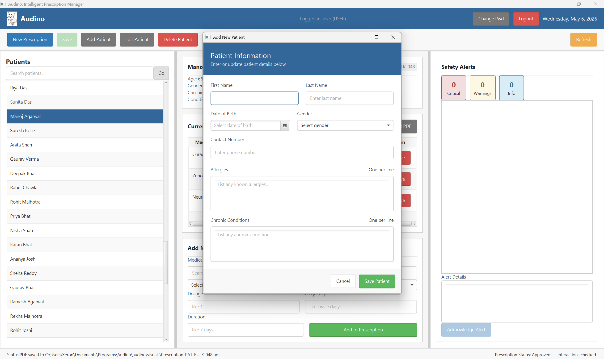
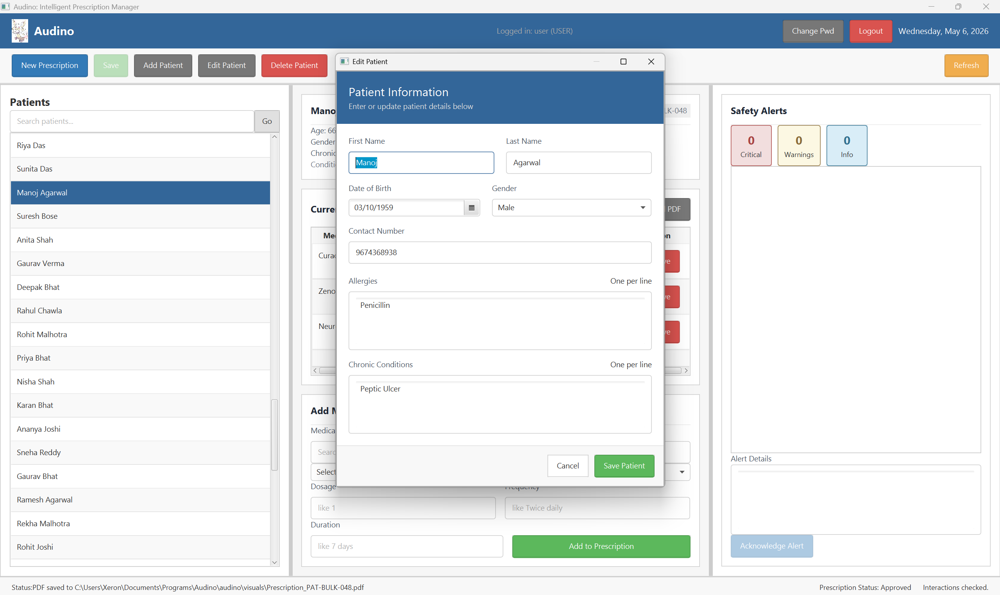
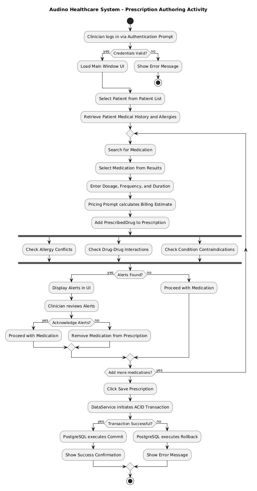
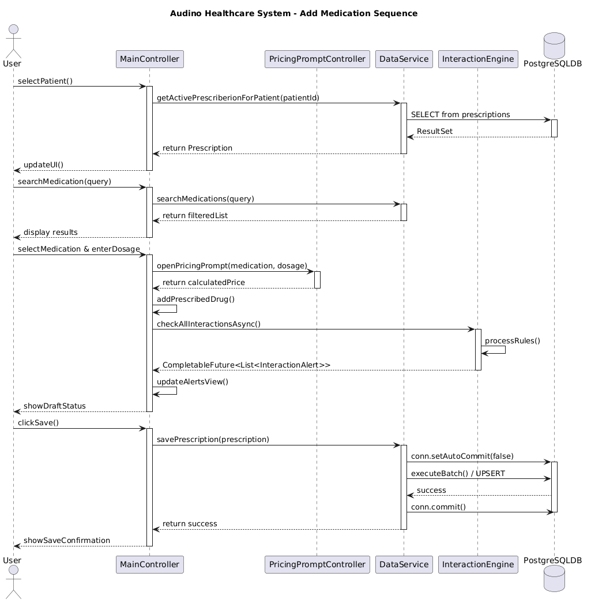

# Audino Frontend Architecture:

## Introduction:
The frontend of Audino is built using JavaFX to provide a robust desktop graphical user interface. It utilizes a strict Model View Controller design pattern to logically separate visual elements from business logic. All views are declared in XML based FXML files, and styling is systematically applied via cascading style sheets.

## Directory Structure:
The frontend architecture is distributed across clearly defined directories to maintain modularity.
* FXML Layouts: All visual layout files reside in `src/main/resources/fxml/`. This includes `MainWindow.fxml`, `Login.fxml`, and `MedicationManager.fxml`.
* Controller Classes: The Java classes binding the layouts to the logic reside in `src/main/java/com/audino/controller/`.
* CSS Styling: The application wide styles are defined in `src/main/resources/css/application.css`.
* Media Assets: Images and graphical resources are housed in `src/main/resources/images/`.

## Backend Integration:
The frontend connects to the backend models and database primarily through the `DataService` and `InteractionEngine` instances.
* Dependency Injection: Upon loading an FXML file, the application programmatically passes the active `DataService` instance to the controller methods.
* Asynchronous Execution: Heavy backend operations like complex PostgreSQL queries or natural language processing search suggestions are executed via asynchronous tasks. This prevents the JavaFX main application thread from freezing during database reads.
* Data Binding: The controllers utilize JavaFX observable list structures. When the backend service updates the clinical models, the observable lists automatically refresh the visible user interface components without manual redraws.
* Transaction Handling: When a user clicks a save button, the controller extracts the text field data, constructs the backend model object, and executes the appropriate `DataService` transaction methods.

## Core Technologies:
* JavaFX 19 is used for the windowing toolkit.
* FXML is used for declarative layout definition.
* JavaFX CSS is used for custom theme applications.

## Main Components:
The system is divided into modular visual components.

### Authentication Window:
This component provides secure access control. It handles user authentication and routes successful logins to the main dashboard.

### Main Dashboard:
This is the primary workspace. It contains the patient list, prescription authoring area, and the dynamic alert banner.

### Medication Manager:
This dialogue allows administrators to update the medication database. It includes form validation and real time interaction previews.

### Patient Data Management:
These modal windows manage the creation and modification of patient demographic and clinical data.

## Interaction Flow:
* Users interact with FXML controls like buttons and text fields.
* Controller classes capture these events using standard view annotations.
* Controllers delegate data processing and constraint validation to the underlying service layer.
* The service layer interacts with the PostgreSQL persistence layer and responds with updated models.
* Controllers refresh the JavaFX properties, updating the visual interface automatically.

## Architectural Diagrams:
The interaction flows map to the backend architecture via controller delegation.

### Activity Diagram:
This illustrates the step by step process flow during user interface interactions.

### Sequence Diagram:
This traces the execution path from the frontend controller down to the database and back.

## Styling And Theme:
* A unified CSS file defines the visual language and branding.
* It sets standard padding, margin, and color variables to maintain design consistency.
* Controls use specific style classes to ensure uniform appearance across all distinct dialogs.
