# Audino: Intelligent Prescription Manager

## System Overview:
Audino is designed as a desktop healthcare application for safe prescription authoring. A JavaFX interface is provided for patient selection, medication search, prescription authoring, and interaction review. Runtime persistence is handled by PostgreSQL so that relational integrity can be preserved for patient, prescription, and medication records.

## Tech Stack Used:
* Language: Java 17.
* UI Framework: JavaFX 19.
* Database Engine: PostgreSQL.
* Database Connection Pooling: HikariCP.
* Database Interaction: Native JDBC.
* Security: BCrypt for role based clinician authentication.
* Build Tool: Apache Maven.

## Features and Functionality:
* Patient Record Management: Create, update, and securely store detailed patient demographics, chronic conditions, and allergy profiles.
* Medication Intelligence System: Search by generic name, brand name, and standard RxNorm identifier codes.
* Autocorrection Pipeline: Typo tolerance via Levenshtein distance and character trigram cosine similarity scoring detects and autocorrects misspelled medication searches.
* Search Recommendations: Context aware dynamic drop down suggestions are powered by Aho Corasick multi token candidate retrieval as the user types.
* Prescription Authoring: An end to end authoring interface captures structured dosage, frequency, duration, unit pricing, and prescribing physician tracking.
* Real Time Clinical Interaction Engine: The system actively prevents harmful cross reactions between concurrently prescribed medications.
* Drug Allergy Interactions: The system flags severe conflicts between prescribed drug classes and patient specific allergies.
* Drug Condition Contraindications: The system warns against prescriptions that aggravate documented chronic patient conditions.
* Dynamic Alerting System: Visual severity categorization actively monitors the authoring flow. Unacknowledged critical alerts prevent prescription finalization.
* Role Based Access Control: Secure login capabilities limit administrative tasks exclusively to authorized clinicians using BCrypt hashed credentials.
* Automated Pricing Estimation: Dynamic cost estimation is calculated using unified prescription duration and dosage logic, yielding precise currency estimations in real time.

## Architecture Summary:
The application is structured with strict Model View Controller boundaries. Safety rule evaluation is delegated to strategy implementations through the interaction engine. Persistence duties are centralized in DataService, and schema control is performed in PostgreSQL through JDBC.

## Documentation Links:
Detailed system documentation is split across dedicated files:
* [Usage Guide](Usage.md) Details operation flows and functionality.
* [Installation and Setup](documentation/InstallationAndSetup.md) Details compilation and environment requirements.
* [Code Base Index](CodeBaseIndex.md) Details the complete source directory layout.
* [Database Architecture](DataBase.md) Details entity relations and PostgreSQL schema.
* [Object Oriented Design](OOPs.md) Details the structural patterns applied.
* [Frontend Architecture](Frontend.md) Details the JavaFX layer and styling methodology.

## Visual Interfaces:
The graphical interface provides multiple distinct functional areas for daily operation.

### System Architecture:
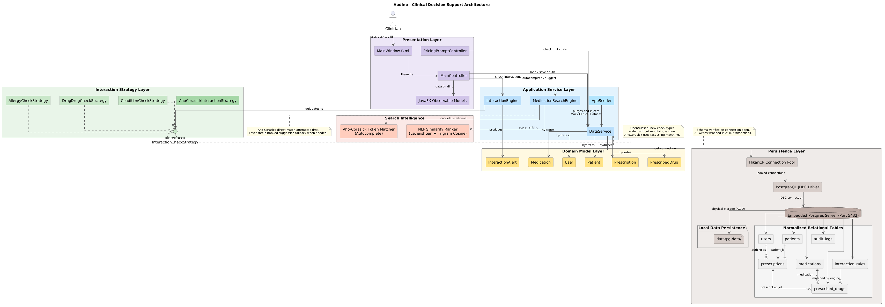
This view illustrates the core components and their interaction pathways.

### Main Dashboard:
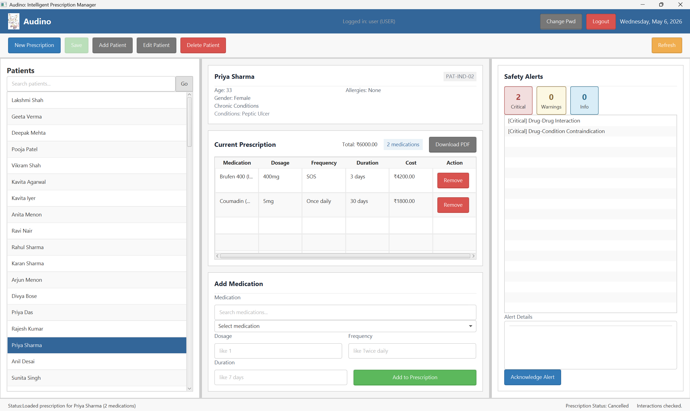
This view provides the primary workspace for selecting patients and authoring prescriptions.

### Authentication Window:
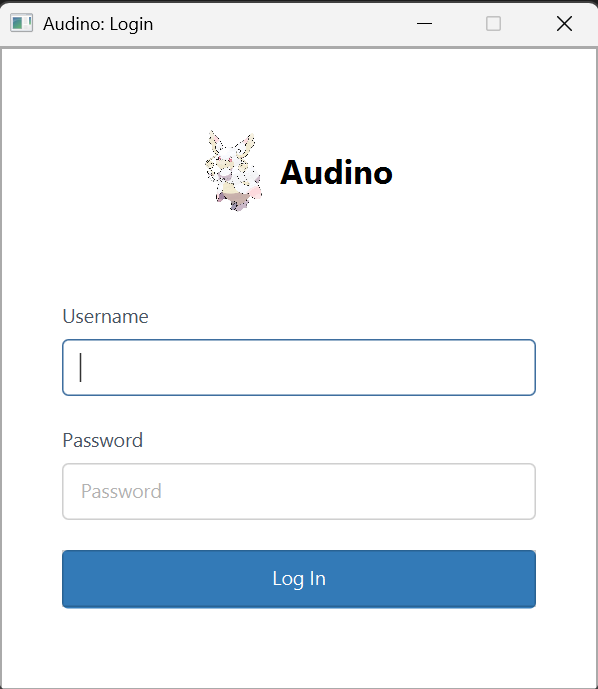
This view provides secure access control using salted BCrypt credentials.

### Add Patient Modal:
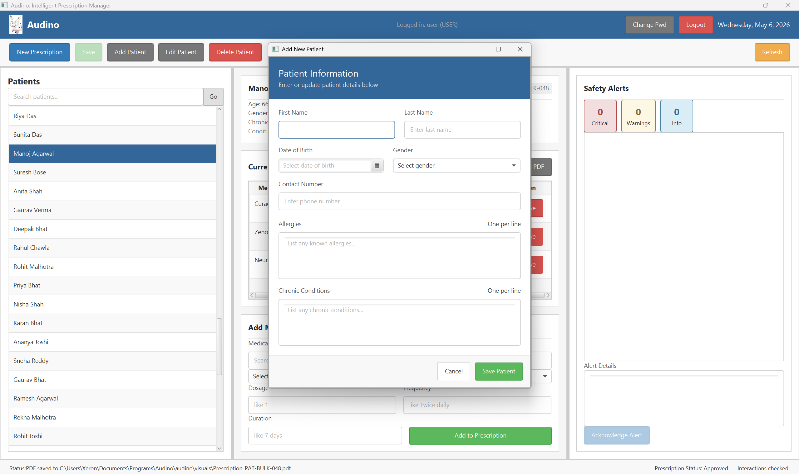
This view collects vital demographic and clinical condition data.

### Edit Patient Modal:
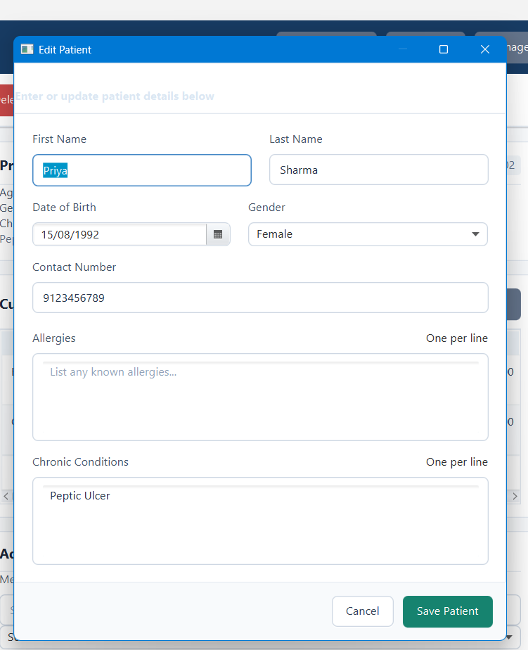
This view updates existing clinical profiles.

### Medication Management Window:
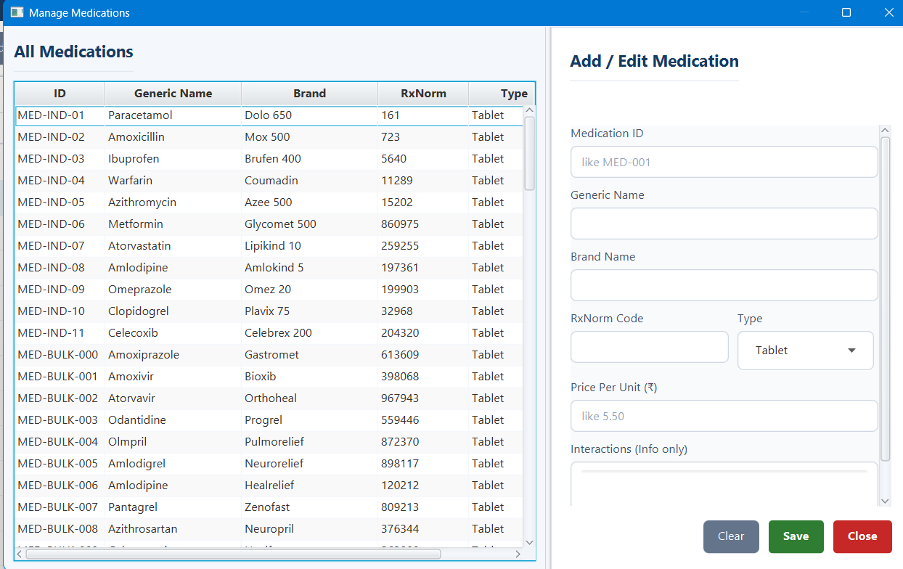
This view permits authorized users to update the core medication database.

### Search Bar Recommendations:
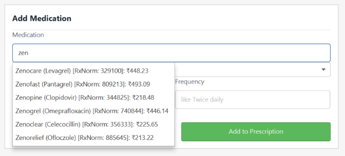
This view dynamically suggests matching medications using an NLP pipeline.

### Interaction Acknowledgements:
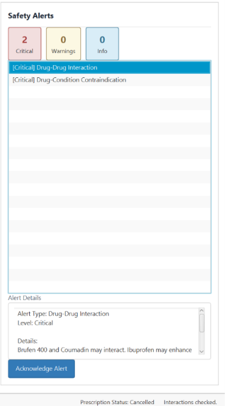
This view forces explicit clinician review of detected drug interactions.

### Generated PDF Document:
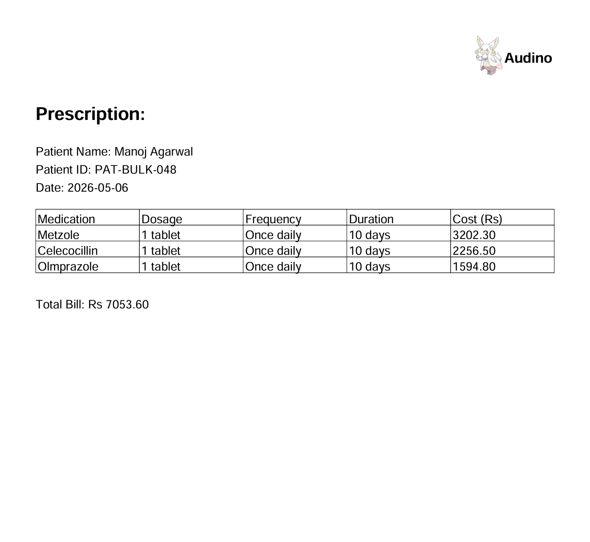
This view displays the dynamically generated branded PDF record for print.

### Audit Logs Dashboard:
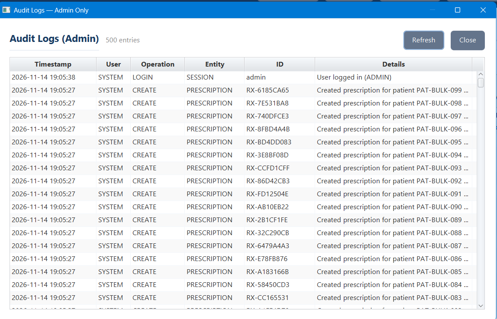
This view displays read only historical system events for security tracking.

### User Management Control:
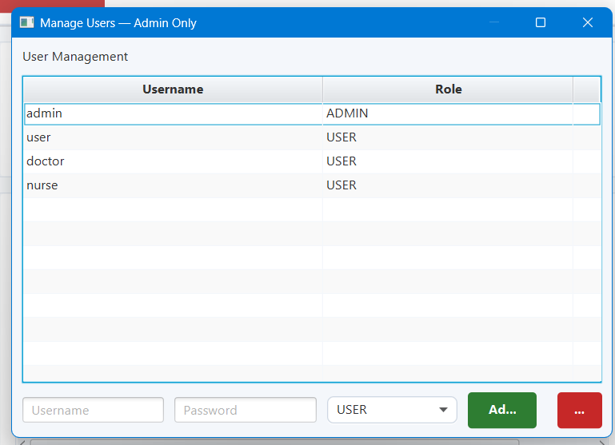
This view permits the provisioning of new clinical accounts.

### Password Configuration:
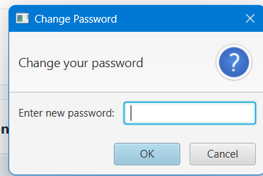
This view allows clinicians to securely update their access credentials.
