# Audino Usage Guide:

## Getting Started:

### Database Storage:
Audino uses a persistent embedded PostgreSQL database. All clinical data is securely stored natively within the project directory.
The default path is located in the data/pg-data directory.

### Populating the Database with Test Data:
To instantly populate the database with a high fidelity clinical dataset, you no longer need to run manual commands.
Audino now features automatic database seeding. On your very first launch, if the application detects an empty database, it will seamlessly inject this comprehensive realistic dataset for you. You can hit the ground running immediately without worrying about manual data configuration.

### Launching the Application:
After installation and optional database seeding, run the application using the start powershell script.
The main window will open displaying the Audino interface.

## Main Features:

### Authentication:
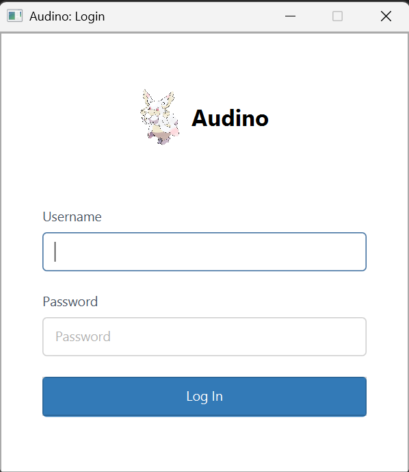
Description: Secure login portal requiring verified BCrypt credentials. It prevents unauthorized access to the clinical system.

### Patient Management:

#### Viewing Patient Information:
Select a patient from the patient list.
Patient details display including name, age, and medical history.
View current allergies and medical conditions.

#### Adding a New Patient:
Click the Add Patient button.
Fill in required fields.
Save the patient record.

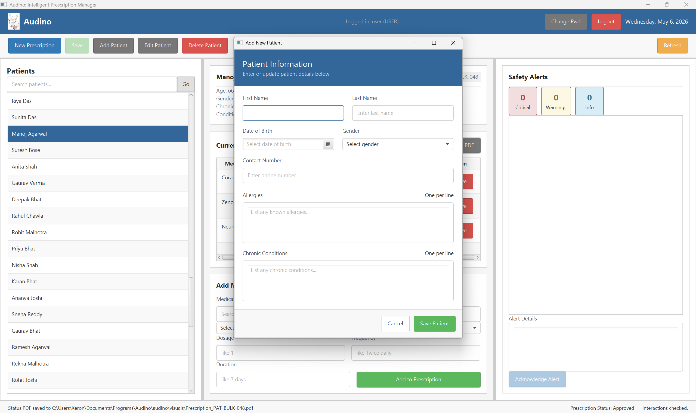
Description: Add new patient window where you can enter patient demographics. It captures critical allergies and chronic conditions upon registration.

#### Editing Prescriptions and Patients:
Select prescription from patient history.
Modify medications or dosages as needed.
Re check for interactions after changes.

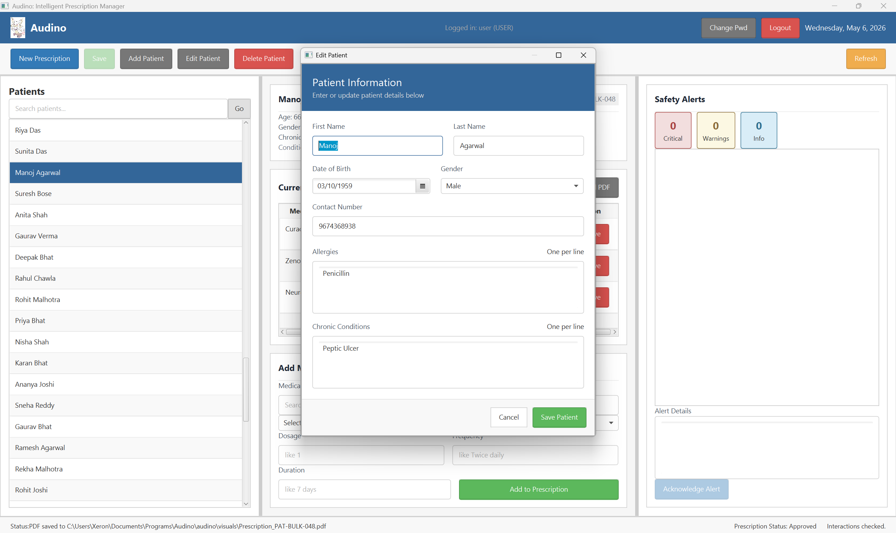
Description: Edit patient dialog allowing you to update existing patient information. It tracks changes to ongoing clinical profiles.

### Medication Database:

#### Browsing Medications:
Access the medication database from the main menu.
Search medications by name or active ingredient.
View detailed medication information including form type and standard dosages.

#### Medication Management Interface:
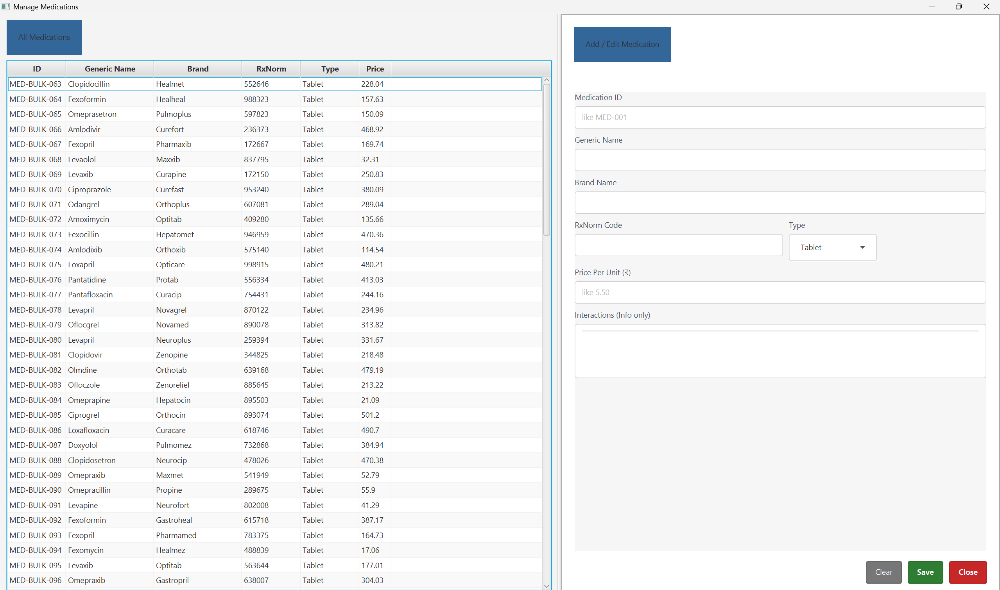
Description: Administrative interface for updating medication unit pricing and identifiers. It ensures the clinical reference library remains current.

### Prescription Creation:

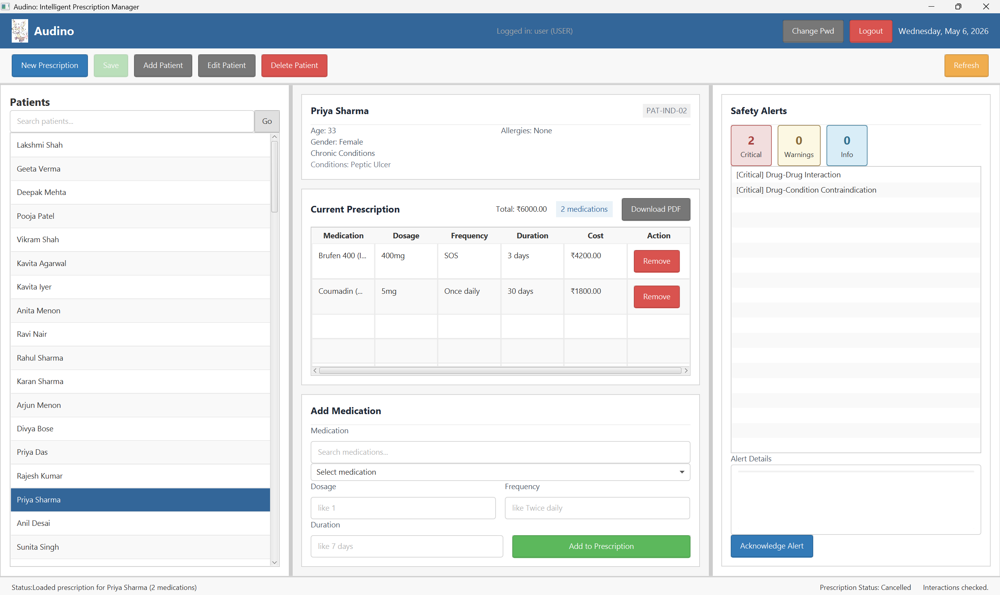
Description: Main window showing patient list on left and medication prescription form in center. It displays active alerts dynamically at the bottom.

#### Creating a New Prescription:
Select the patient for whom the prescription is being created.
Click New Prescription button.
Add medications to the prescription.
Specify dosage and frequency for each medication.

#### Intelligent Search Interface:
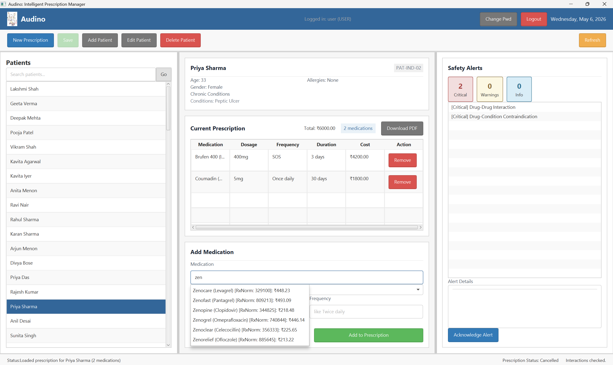
Description: Drop down search suggestions with typo tolerance. It prevents medication entry errors using NLP distance metrics.

#### Interaction Checking:
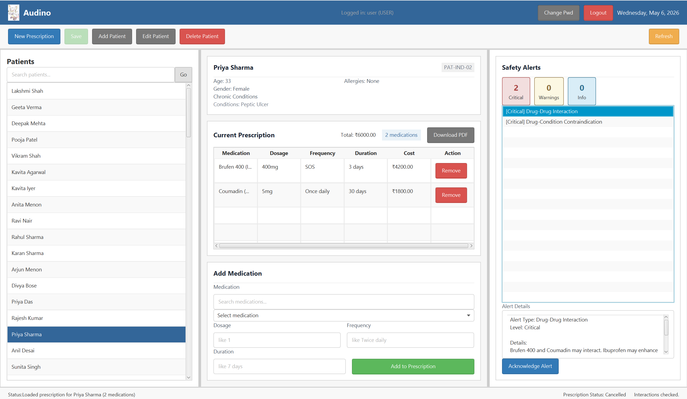
Description: Clinical safety warning panel. It demands physician review before proceeding with a dangerous drug combination.

#### PDF Export:
Audino provides built in professional PDF generation for active prescriptions.
Click Download PDF to instantly export a fully formatted, branded prescription record complete with tabular medication instructions and automated total billing.

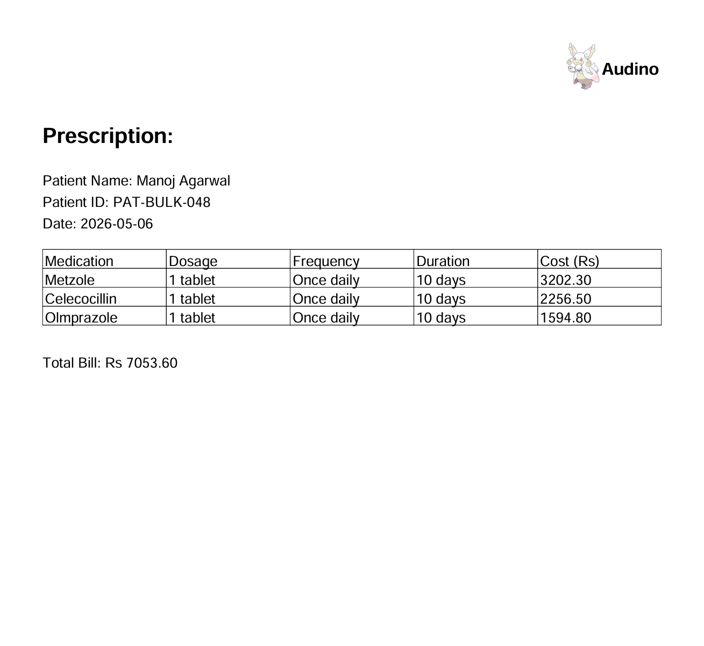
Description: A generated PDF document demonstrating hospital branding and patient instructions. It compiles the finalized clinical data into a printable asset.

### Example Prescription Reference:
For a tangible example of the system output, please review the sample PDF.
[Example Prescription PDF](documentation/Prescription_PAT-BULK-048.pdf).
This file demonstrates a real world prescription structure generated by the platform. It includes header branding, patient identifiers, tabular drug dosages, and automated total price calculations.

### Security and Audit Logs:
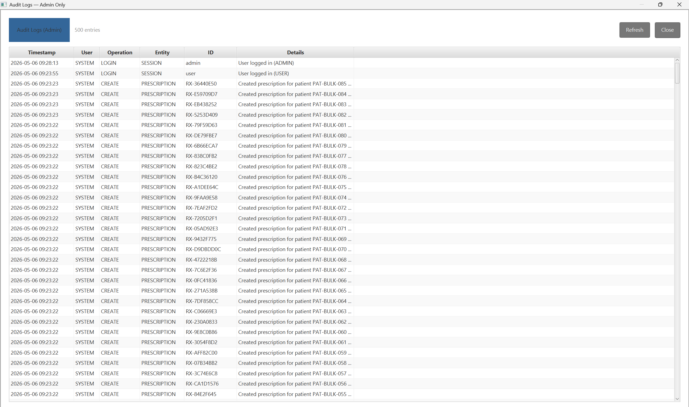
Description: An administrative log viewer tracking all backend events. It records logins, database modifications, and clinical alerts.

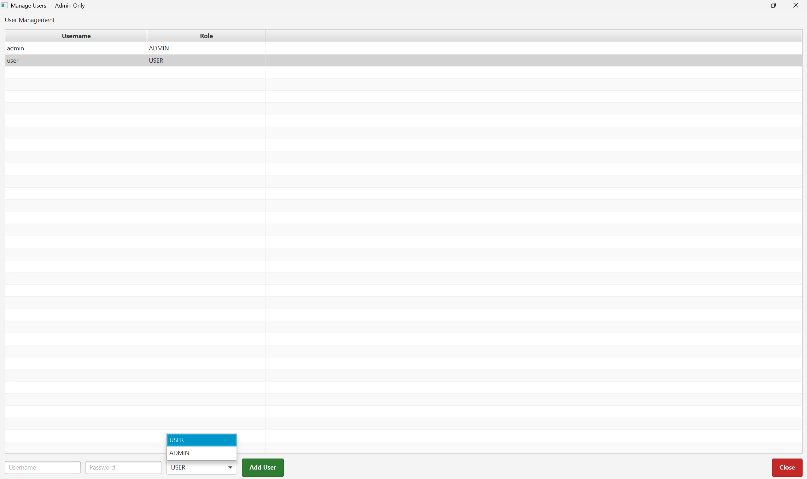
Description: A secure credential generation panel. It allows administrators to securely onboard new clinical staff.

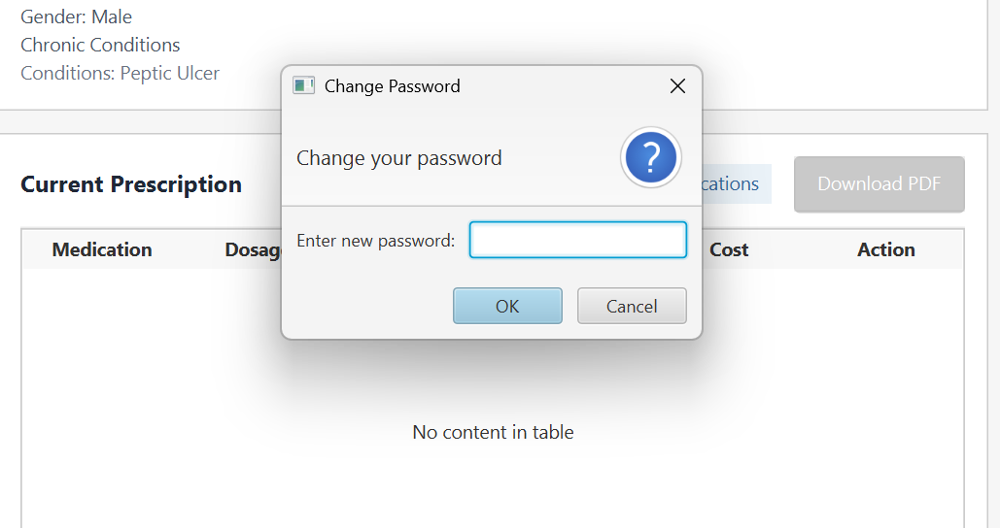
Description: A self service credential reset panel. It utilizes salted hashing to ensure password integrity.

## Best Practices:

### For Safe Prescribing:
Always review patient allergies before prescribing.
Check patient current medical conditions.
Never ignore CRITICAL level alerts.
Document reasons for overriding alerts.
Update patient information regularly.

### For Optimal System Use:
Keep medication database current.
Regularly update interaction rules.
Back up patient data frequently.
Train staff on alert interpretation.
Review system reports periodically.
